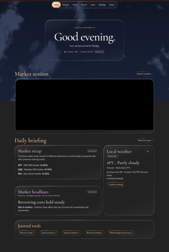
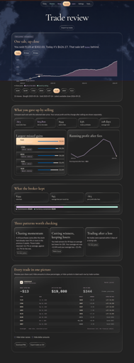

# Hindsight

Hindsight is a private market journal for learning from completed trades. It combines a calm seasonal journal with TradingView charts, a full FIFO trade review, market news, weather context, and illustrated lessons.

The v2 journal includes Today, Markets, News, Review, Learn, Settings, and Tools. Review accepts broker CSV, TSV, or TXT exports and keeps them in the browser. It shows the original Hindsight report sections for sale charts, missed upside, cumulative results, fees, habits, and shareable exports.

## Visual previews

The original mark is available at public/brand/hindsight-mark.svg.
Use Node 22 or newer. From this directory run `npm ci`, copy `.env.example` to `.env`, then run `npm run dev`. Open the local URL printed by Vite.
Run `npm test`, `npm run lint` and `npm run build` for verification. `npm run preview` serves the production bundle with the local API handlers.
## Hosting
Vercel can serve the Vite build in `dist` and the functions in `api` on the same origin. Configure the environment in the host's secret settings. For another static host, serve the build and route market API requests to equivalent Node functions. Hash routes support subdirectory hosting.
## Providers
Set FINNHUB_API_KEY for news, stock quotes and index/sector ETF comparisons. OPENAI_API_KEY optionally enables written recaps with OPENAI_MODEL. Keep all keys server-side. Restart the dev server after changing .env.
Weather, city search and TradingView use public services. Chart and quote availability depend on symbol coverage and provider access.
## Artwork
Replace the twelve gradient WebPs in `public/assets/bg` using `docs/IMAGE_PROMPTS.md`. Export 2560×1440 originals and 768×432 mobile versions with the existing -small suffix.

