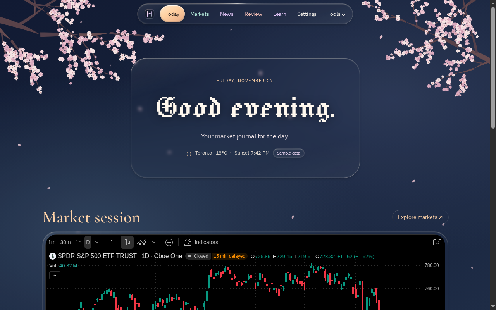
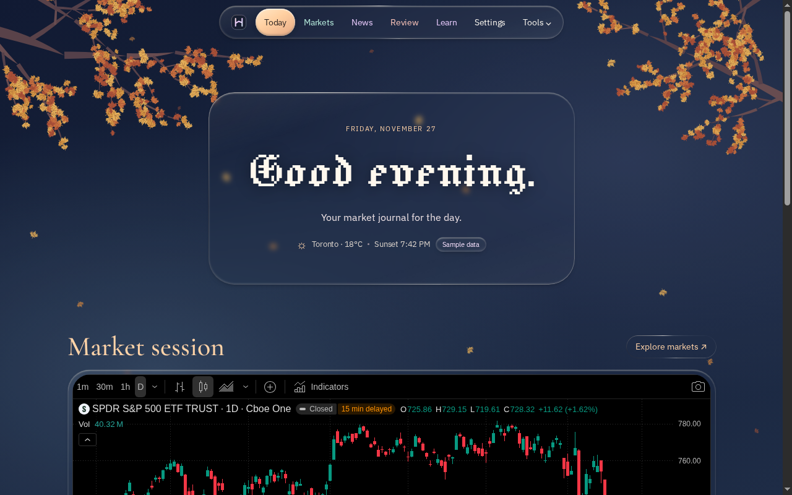

# Hindsight 3.2.1

Hindsight is a browser-based market journal for reviewing completed trades. Import a broker export, see how purchases and sales pair up, and explore what prices did after each sale. The Today page brings together charts, market headlines, and optional weather-based seasonal scenery.

[Open Hindsight](https://plinluu.github.io/hindsight/) · [Download the built website](https://github.com/plinluu/hindsight/releases/download/v3.2.1/hindsight-v3.2.1-web.zip)

## Screenshots

| Spring | Autumn |
| --- | --- |
|  |  |

## Privacy and security

Broker files are parsed in the browser. Opening a TradingView chart sends the selected symbol to TradingView. Optional weather and city search send coordinates or a city query to Open-Meteo. Preferences and weather cache are stored in the browser. The live chart loads when you choose to connect to TradingView.

The static release contains no server-side API handlers. It links to market publishers and labels sample data. The optional server feeds are disabled by default. Enable them only after confirming permission for your sources and keeping provider keys in the server environment. Report suspected vulnerabilities privately and omit credentials, trading records, and personal information. [Security reporting](SECURITY.md)

## Running the download

Extract the release ZIP. From the directory **containing** the extracted `hindsight` folder, run `python3 -m http.server 8000 --bind 127.0.0.1` and open [the local journal](http://127.0.0.1:8000/hindsight/). The download contains the compiled site and uses the same URL layout as GitHub Pages.

## Working from source

Use Node.js 22 or later. Run `npm ci` and `npm run dev`. Run `npm test` and `npm run lint` to check changes. For the GitHub Pages build, run `npm run build -- --base=/hindsight/`. Vite writes the static files to `dist/`. For a deployment with server-side market APIs, see the handlers in `api/` and the example environment settings in `.env.example`.

## Terms and reuse

Hindsight is for personal education. Verify trade calculations against your broker’s records. Prices, illustrative examples, and historical comparisons are not investment advice.

© 2026 plinluu. The license covers Hindsight’s original code, branding, and artwork. Third-party components and data retain their own terms. The reuse notice addresses copying, redistribution, and AI training. [License](LICENSE) · [Copyright and reuse](COPYRIGHT.txt) · [Third-party notices](public/third-party-notices.txt)
