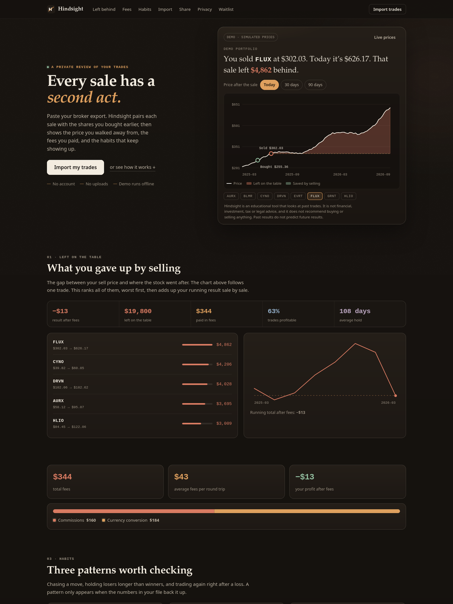
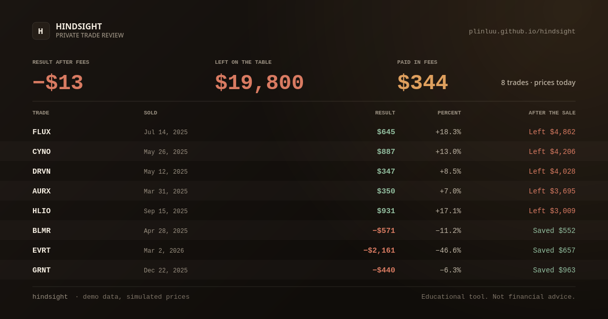

<h1 align="center">Hindsight</h1>

<p align="center"><strong>See what your trading really cost you.</strong><br>
A private, browser-only review of every sale, every fee, and the habits behind your results.</p>

<p align="center">
  <a href="https://plinluu.github.io/hindsight/"><strong>Live demo</strong></a>
  &nbsp;·&nbsp;
  <a href="#features">Features</a>
  &nbsp;·&nbsp;
  <a href="#privacy-and-security">Privacy</a>
  &nbsp;·&nbsp;
  <a href="#run-locally">Run locally</a>
</p>

<p align="center">
  
</p>

Hindsight is a static, browser-only trade review. Import a broker export, pair every sale with the shares you bought earlier, and see what happened after you sold — plus what fees and habits did to the result. There is no backend, no build step, no account, and no upload.

> **Not financial advice.** Hindsight is an educational review tool. It does not recommend buying or selling any security. Past results do not predict future returns.

## At a glance

| 🔒 Private by default | 📊 Built for review | 🪶 Lightweight |
|:--|:--|:--|
| Trades are parsed on your device and never uploaded or saved. No analytics, cookies, or third-party scripts. | FIFO matching, per-trade price charts, missed upside, fee totals, running results, and habit checks. | Plain HTML, CSS, and JavaScript. No framework, no package install, no build step. |

**[Open the live demo →](https://plinluu.github.io/hindsight/)** · The demo works offline with simulated prices.

## Features

- **Demo mode that works offline.** A made-up eight-ticker portfolio with simulated weekly prices, so the charts and report render before you import anything.
- **Flexible import.** CSV, TSV, or TXT, or paste the table from a broker page. Hindsight detects the delimiter and the header row, proposes column matches, and lets you correct them. Files are capped at 2 MB and 20,000 data rows; binary files are rejected with a clear message.
- **FIFO trade matching.** Sales are matched against earlier purchases first in, first out. Partial lots, commissions, and unmatched sales are handled and reported.
- **Price chart per trade.** See the buy, the sale, what the stock did next, and the area between the sale price and later prices. Toggle between today, 30 days after the sale, and 90 days after the sale.
- **Report sections.** Result after fees, money left on the table, fees paid, profitable-trade share, average hold, a biggest-regret leaderboard, a cumulative result chart, a fee breakdown, and descriptive habit checks (chasing momentum, holding losers, trading after a loss).
- **Share card.** Download one PNG listing every analyzed trade, biggest regret first, with totals and fees at the top. Up to 30 rows, then an "and N more" line. Hide tickers and hide dollar amounts (percentages stay) before sharing. The card footer reads "Educational tool. Not financial advice."
- **CSV export.** Download the analyzed trades, including the later price used for the selected horizon. Spreadsheet formula injection is neutralised.
- **Optional live prices.** Fetch weekly closes directly from Alpha Vantage with your own free API key, cached for 12 hours. The UI shows progress, handles rate limits and bad symbols, and never puts the key in a URL, log, or page address.

## Share card

<p align="center">
  
</p>

Every review can become a PNG for sharing. The card lists each trade with its result and what the sale left behind, sorted by the biggest miss. Small reviews fit in 1200 × 630; longer ones grow up to 30 rows. Both privacy toggles apply to every row.

## Live demo

The deployed site is at **<https://plinluu.github.io/hindsight/>**.

To run it yourself, see [Run locally](#run-locally). Demo mode, import, export, the share card, and the data controls all work without an API key. Live prices require your own free Alpha Vantage key.

## Privacy and security

Hindsight is designed to keep your trade file on your device.

- Imported trades are parsed in the browser and are **never uploaded or saved**. Refreshing the page returns to the demo.
- There is no backend, no analytics, no cookies, no third-party script, and no external font. The page loads only local `style.css`, `core.js`, and `app.js`.
- The only network request the app makes is to `https://www.alphavantage.co`, and only when you click **Fetch prices**.
- The Alpha Vantage key is stored in this browser's `localStorage` (only if you paste one) and is sent only in the Alpha Vantage query string. It is never logged, never placed in the page URL, and never sent anywhere else.
- Cached weekly price series are stored in `localStorage` under `hs_s_<TICKER>` and expire after 12 hours. **Forget my key** removes just the key. **Delete all my data** removes every Hindsight `hs_*` key and cached price series but leaves other applications on the same origin alone.
- The page sets a strict Content Security Policy meta tag, `no-referrer`, and an inline SVG favicon. All CSS and JavaScript live in separate local files, so the policy needs no `unsafe-inline`.
- User-supplied text is written with `textContent` / DOM APIs, not `innerHTML`.

The exact CSP delivered by `index.html` is:

```text
default-src 'none'; script-src 'self'; style-src 'self'; img-src 'self' data:; font-src 'self'; connect-src https://www.alphavantage.co; base-uri 'none'; form-action 'none'
```

A meta-tag CSP is defence in depth, not a substitute for a response header. If you host Hindsight somewhere that supports headers, send the same policy as a `Content-Security-Policy` response header.

See [SECURITY.md](SECURITY.md) for the full security model and how to report a problem. Please do not open a public issue for a vulnerability.

## Configure the waitlist link

The waitlist is a single external link. No form is embedded and no email is collected by this site.

1. Open `app.js` and set the address at the top:

   ```js
   var WAITLIST_URL = "https://tally.so/r/your-form-id";
   ```

2. Leave it empty and the button stays on the page and explains that the waitlist opens soon, instead of acting like a dead link.

With a real address, the link gets `target="_blank"` and `rel="noopener noreferrer"`. The static `href="#waitlist"` fallback in `index.html` is only there for the no-JavaScript view.

## Legal sections and placeholders

The page ends with **Not financial advice and risk**, **Terms of use** and **Privacy** sections. The footer links to all three, and the short disclaimer appears under the hero results card and again in the footer on every view. The share card adds "Educational tool. Not financial advice." to its footer.

Three values are placeholders and must be replaced before launch:

| Placeholder | Where | What to put there |
| --- | --- | --- |
| `[GOVERNING LAW, e.g. Province/State and Country]` | `index.html`, Terms section | The law that governs your site |
| `[YOUR EMAIL]` | `index.html`, Terms section | A contact address, plain text by default |
| `X_URL` (empty string) | `app.js`, top of the script | Your X profile URL, e.g. `https://x.com/your-handle` |

While `X_URL` is empty, the X icon stays hidden instead of rendering a dead link. The GitHub icon always points at <https://github.com/plinluu/hindsight>. Both icons are inline SVG, open in a new tab with `rel="noopener noreferrer"`, and use 44 px tap targets.

## Run locally

```bash
python3 -m http.server 8000
```

Then open <http://localhost:8000/>. A local server is recommended because browsers restrict some file and storage behaviour on `file://` URLs.

There is no build step and no dependency to install.

## Tests

The parsing, matching, price, and CSV logic is isolated in `core.js` and runs under Node's built-in test runner:

```bash
node --test tests/core.test.js
```

The suite covers:

- BOM, CRLF, quoted commas, escaped quotes, quoted newlines
- comma, tab, and semicolon delimiters; headers below broker preamble lines
- the 2 MB and 20,000-row limits and binary/empty rejection
- broker-style numbers and dates, leap years, month and year boundaries
- column detection and nullable optional columns
- FIFO matching, partial lots, same-day ordering, prorated fees
- unmatched sales and ignored rows
- revenge-trade flagging
- weekly-series parsing, `priceAt`, `horizonPrice`, enrichment, regrets
- CSV escaping and spreadsheet formula-injection protection

No test framework or npm package is required. Node 20 or newer is recommended.

## Repository layout

| Path | Purpose |
|---|---|
| `index.html` | Page shell, content, metadata, and security policy |
| `style.css` | Complete dark theme and responsive layout |
| `core.js` | DOM-free parsing, matching, pricing, and CSV logic |
| `app.js` | UI, demo data, live fetch, charts, sharing, and data controls |
| `tests/core.test.js` | Node test suite for `core.js` |
| `assets/og-card.png` | 1200 × 630 social preview card |
| `docs/screenshot.png` | Screenshot used in this README |

## Deploy on GitHub Pages

This repository currently deploys from the `upgrade-v1` branch:

1. Open **Settings → Pages**.
2. Choose **Deploy from a branch**, then `upgrade-v1` and `/ (root)`. Save.
3. The site appears at `https://<user>.github.io/hindsight/`.

If you later merge into `main`, switch the Pages branch to `main` in the same screen.

If you fork the project or use a custom domain, update the canonical URL and the `og:url` / `og:image` / `twitter:image` values in `index.html`, plus the footer label on the generated share card in `app.js`.

The waitlist URL is the only feature that needs a value before launch. Demo mode and import/export work without any configuration.

## Browser support

Current evergreen Chrome, Edge, Firefox, and Safari. Hindsight uses `fetch`, `canvas`, `Intl`, CSS custom properties, and modern DOM APIs. It does not support Internet Explorer.

## Limitations

- **FIFO is a simplification.** Hindsight pairs buys and sells of the same symbol chronologically. It does not model short sales, options, dividends, transfers, splits, mergers, or multi-currency cost bases. A transfer or corporate action can leave a sale unmatched.
- **Prices are weekly closes.** The chart is a review aid, not a tick-level execution record. Alpha Vantage's weekly series is also not adjusted for corporate actions, so long-horizon comparisons around a split or spinoff can be misleading.
- **A free Alpha Vantage key is rate-limited** (about 25 requests per day). Each uncached ticker costs one request and fetches are spaced 13 seconds apart. Use a free key only; never paste a paid, shared, or company key.
- **Habits are descriptive.** A pattern flag means the numbers in your file fit the pattern, not that the pattern caused your result. Small samples are marked as hints, not proof.
- **Not financial advice.** Hindsight is an educational review tool and does not recommend buying or selling any security.

## Project status

v2.0 (branch `polish-v2`): warmer editorial theme, seven section anchors, a chart-first hero, an all-trades share card, a waitlist that says when it is not live yet, and legal sections with footer social links.

- [x] CSV and pasted-table import with column matching
- [x] FIFO matching, fee audit, and price charts
- [x] Share card and CSV export
- [x] Live prices with a visitor-owned free key
- [ ] Verify against more real broker exports
- [ ] Optional paid tier with a server-side data proxy

## License

MIT © 2026 plinluu. See [LICENSE](LICENSE).
